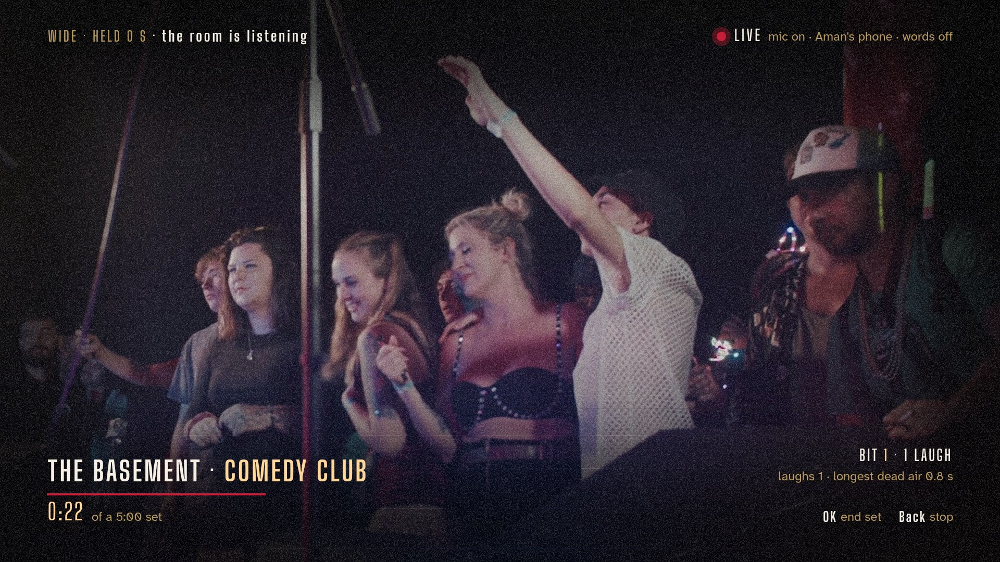
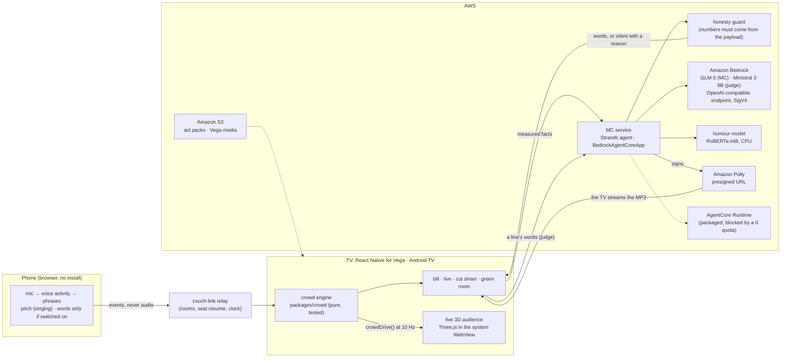

# Encore

**A real audience, honestly scored.** Put your phone on the table, stand up, and your TV becomes the room: an open mic, a comedy club, a theatre, an arena. A live 3D audience reacts to your timing (and, if you allow it, to your words). It laughs on the beat you leave, gets restless in dead air and heckles you in a tough club. Afterwards, the cut sheet shows your set as an edit timeline with the measured numbers beneath it, and an MC you chose debriefs you out loud.

Built for the [Build, Ship, Shape: Amazon Developer Hackathon](https://amazonappdev2026.devpost.com): the Fire TV track, plus the AWS Builder and Open Source mini challenges.

> **Status (2026-10-12).**
> - **Runs end to end:** on an Android TV (a 32-bit Mali-G31 Google TV, release APK), on the Android TV emulator, and in a desktop browser preview.
> - **The Vega build** (React Native for Vega, SDK 0.24) runs on the Vega Virtual Device with the MC's voice and packaged media. The 3D room doesn't run there: the Linux simulator has no WebView, so Vega shows licensed video plates instead.
> - **Untested on Fire TV hardware.**
> - **Known limit:** the 3D room runs at about 20–24 fps on the Mali-G31 TV against a 30 fps target (`docs/tv-test-log.md`).

## Screenshots

From the Android TV emulator, driven by the engine on a set from the scripted test phone (`fake-phone`); every caption and number is the engine's own output.

| Tonight's bill (720p) | A laugh, with the director's reason | The heckle after two dead bits |
|---|---|---|
|  |  |  |

| Words on: "the punch turns 'winter'" (720p) | The cut sheet and the MC's note (720p) | The same app on the Vega Virtual Device |
|---|---|---|
|  |  |  |

More captures: `docs/android-emu/` (emulator takes with their raw logs in `stats.txt`), `docs/vega/` (the Vega simulator), `docs/mockups/` (renders and design comps). The submission gallery plan is `docs/submission/gallery.md`.

## What it does

- **Four acts, four venues, one score.**
  - **Acts:** stand-up (the room laughs), poetry (it snaps), speeches (it applauds), singing (it cheers).
  - **Venues:** Open Mic, Comedy Club, Theatre and Arena. A tougher venue raises the bar before the room reacts, shortens its patience with dead air and brings hecklers, but the scorecard counts against one house standard everywhere.
- **A room that hears timing first.** It listens for the beat you leave after a line, a short punch after a longer setup, emphasis at the end of the line, a clean line without fillers, and a note held in tune. With words on, it also counts devices (a callback, wordplay, a list of three, a rhyme, a contrast, a call to action) and asks a content judge on Amazon Bedrock for one estimate per line, labelled as an estimate.
- **A live 3D audience.** Three.js in the TV's WebView, driven only by the engine's measurements. Microsoft Rocketbox people with motion-captured movement, and each laugh a fresh mix of real CC0 recordings.
- **An MC, not a chatbot.** Four personas (warm, sarcastic, strict, deadpan) introduce you, heckle you, debrief you out loud, remember your last six sets and answer you in the green room. Every word comes from the model, and is checked by a guard. When the model can't answer, the MC is silent and the screen says why.

The honesty rules every screen follows (full text in `docs/concept-encore.md`):

1. The room reacts to what was measured, and the ledger reports what was measured. Every reaction carries its measured reason.
2. A tougher venue changes the crowd, never the score.
3. "Unsure" is grey and never counts against the performer. With words off, pace and fillers read "not measured", never zero.
4. The app never sends audio anywhere. Words leave the phone only when you switch them on, and the TV shows how they're recognised.
5. The MC is the model or it is silent. There are no template lines.
6. Nothing is faked for the demo.

## Architecture



**One set, end to end.**
1. The TV opens a couch-link room and shows a QR code. The phone joins, starts its microphone and reports that it's ready.
2. OK sends `arm`. The phone waits for the shared start time and streams events: voice on and off, each phrase's timings and levels, pitch for singing, and words if switched on.
3. The TV feeds the events, plus a tick ten times a second, into the pure engine (`reduceSet`). The engine decides the reactions, the camera cuts, the title cards, the heckles and the scorecard. `crowdDrive()` turns that state into what the 3D room does.
4. During the set the TV asks the MC service for moment lines (intro, between bits, heckle, the end) and, with words on, for one judge verdict per line within the engine's deadline.
5. After the set the TV builds a set record, asks for the debrief (text plus a presigned Polly URL), shows the cut sheet, and keeps the last six records for the green room.

The TypeScript contract is `packages/crowd/src/types.ts` and `messages.ts`. The MC service mirrors it in pydantic (`services/mc-agent/src/mc_agent/models.py`).

## Quick start

**Requirements:**
- Node 22 (`.nvmrc`) and Yarn 4 through corepack;
- Python 3.12 with `uv`;
- for the MC, an AWS account with Bedrock and Polly access;
- for words mode, an Android phone with Chrome on the same Wi-Fi.

```bash
nvm use && corepack enable && yarn install
yarn test            # engine, couch-link, pitch-judge, relay (includes a WebSocket end-to-end test)
yarn test:agent      # the MC service (uv + pytest)
```

### 1. Local development: the TV in a browser

```bash
yarn dev:relay       # WebSocket relay on :8787 (health at /health)
yarn dev:companion   # the phone page on https://<your LAN IP>:5173 (self-signed; accept the warning once)
yarn dev:mc          # the MC on :8080 (see "The MC service" for credentials and settings)
yarn dev:tv-web      # the TV in a desktop browser on http://localhost:8082 (arrow keys, Enter = OK, Backspace = Back)
```

- **Your address:** set your laptop's LAN address in `packages/shared-ui/src/encore/config.ts` (`LAN_HOST`); the QR code points there.
- **No phone?** Replay a recorded set: `http://localhost:8082/?demo=club&t=190` or `?demo=arena&t=36`.
- **The 3D room in the browser:** serve the crowd page with `cd prototypes/crowd3d && python3 -m http.server 8091`, then add `?crowd=3d` to the TV URL.
- **Without the MC:** the show still runs, and the MC is shown as unavailable, with the reason.
- **WSL2:** the phone can't reach WSL's ports in NAT mode. See `docs/dev-setup.md` §2 for mirrored networking or a port proxy.

### 2. The phone page

Open `https://<LAN IP>:5173/?room=CODE` (the QR code on the bill does this), accept the certificate once, and tap **Start listening**. Phones only allow the microphone on HTTPS pages, which is why the dev server uses TLS and proxies `/relay` to the relay (`RELAY_URL`; `VITE_RELAY_URL` bypasses the proxy). Words need Chrome on Android, and the page says whether recognition runs on the device or through a service. Without a phone, `yarn workspace @strumble/relay fake-phone --room CODE --words scripts/standup-demo.json` performs a scripted test set; start the relay with `RELAY_DEBUG_ROOMS=1` for it.

### 3. The Android TV build (and the Android TV emulator)

```bash
cd apps/tv-expo && EXPO_TV=1 npx expo prebuild --platform android --no-install    # once; android/ is generated
node ../../prototypes/crowd3d/tools/pack.mjs android/app/src/main/assets/crowd --tv  # the 3D room, packed for file://
cd android && ./gradlew assembleRelease -PreactNativeArchitectures=armeabi-v7a       # x86,x86_64 for the emulator
adb install -r app/build/outputs/apk/release/app-release.apk
adb reverse tcp:8787 tcp:8787 && adb reverse tcp:18080 tcp:8080                      # relay and MC from the TV
```

- **Toolchain:** JDK 17 with a compiler, plus the Android SDK (platform 36, build-tools 36, NDK 27.1.12297006).
- **Release build details:** memory caps and the two-step bundle are in `docs/dev-setup.md`, "Building the TV app for the Google TV". **[verify]** that the three commands above reproduce the box's `~/build-apk.sh`, which isn't in the repo.
- **Cleartext:** the release APK allows plain HTTP and WS to localhost only, since every service reaches it through `adb reverse`.
- **The 3D room** is on by default on Android. `com.strumble.tv://stage?crowd=off` turns it off.
- **The 720p Android TV emulator** we film on is `system-images;android-34;android-tv;x86` with the `tv_720p` device, started with `-gpu host`. The scripts are `docs/android-emu/720p-test/emu720.sh` and `set720.sh`.

### 4. The Vega build (Fire TV on Vega OS)

```bash
# Vega SDK 0.24.12044 (unattended install: NONINTERACTIVE=true SKIP_SDK_INSTALL=true bash get_vvm.sh; vega sdk install 0.24.12044)
yarn pack:crowd                       # the 3D room into apps/vega/assets/crowd (for hardware with a WebView)
rm -rf apps/vega/build && yarn build:vega:debug
cd apps/vega && tools/vvd.sh up && tools/vvd.sh repack && tools/vvd.sh install
```

- **The simulator:** the Linux Vega Virtual Device needs `-gpu host` on a GPU-less host, which `vvd.sh up` handles.
- **No WebView there:** it has no WebView, so `vvd.sh repack` strips that dependency from a simulator-only package. Never install that package on hardware.
- **Addresses:** on the simulator the TV reaches the relay and the MC at `10.0.2.2`.
- **Media:** packaged media plays from `/pkg/assets/raw/…`, and `VEGA_MEDIA_BASE` in `world/sound.vega.ts` is the HTTPS fallback on S3.
- **More:** the whole setup is in `docs/dev-setup.md`, "Vega on AWS", and every workaround is in `docs/friction-log.md`.

### 5. The MC service

```bash
cd services/mc-agent && uv sync      # add --group humor for the stand-up humour model
aws login                            # or an instance role; botocore[crt] is already a dependency
uv run python -m mc_agent.app        # POST http://localhost:8080/invocations, kinds: debrief, chat, line, judge
```

| Variable | Default | What it does |
|---|---|---|
| `MC_PROVIDER` | `mantle` | `mantle`: Bedrock's OpenAI-compatible endpoint (`https://bedrock-mantle.<region>.api.aws/v1`, SigV4). `converse`: Strands `BedrockModel` |
| `MC_MODEL_ID` | `zai.glm-5` on mantle | the model that writes every MC word (keep `config.mcModelLabel` in step) |
| `MC_REGION` | `AWS_REGION`, else `ap-south-1` | Bedrock region |
| `MC_TIMEOUT_S` / `MC_LINE_TIMEOUT_S` | 8 / 3.5 | budgets for the debrief and chat, and for moment lines during a set |
| `MC_JUDGE_MODEL_ID` / `MC_JUDGE_TIMEOUT_S` | `mistral.ministral-3-8b-instruct` / 0.35 | the content judge's LLM and its budget |
| `MC_HUMOR_MODEL_DIR` / `MC_HUMOR_THREADS` | unset / 2 | the int8 ONNX humour model (`model.int8.onnx`, `tokenizer.json`; build steps in `services/mc-agent/deploy/README.md`) |
| `MC_VOICE_REGION` / `MC_VOICE_PREMIUM_REGION` | the MC region / `ap-southeast-1` | Polly neural (fallback) and generative (premium) regions |
| `MC_VOICE_<PERSONA>` | Kajal, Brian, Stephen, Matthew | voice overrides (`WARM`, `SARCASTIC`, `STRICT`, `DEADPAN`) |
| `MC_VOICE_SIGNER_ROLE_ARN` | unset | sign the Polly URLs with an assumed role |
| `MC_WARM`, `MC_KEEPALIVE_S` | on, 45 | the warm model connection and how often it's touched (`MC_WARM=0` turns both off) |
| `MC_KEEP_ALIVE_S` | 75 | how long the HTTP server keeps an idle client connection open |
| `MC_BACKEND`, `MC_AGENTCORE_ARN` | `local` | `agentcore` makes the service a keyless forwarder to an AgentCore runtime |
| `PORT` | 8080 | the service port |

The answer is `{note}`, `{reply}`, `{line}` or `{verdict}`, or `{unavailable: {reason}}` (`timeout`, `no-credentials`, `model-error`, `rejected`, `unreachable`). A worked `curl` example is in `docs/dev-setup.md` §4.

### 6. The AWS pieces

- **IAM:** the MC needs `bedrock-mantle:CreateInference`, `bedrock:InvokeModel`, `polly:SynthesizeSpeech` and `polly:DescribeVoices`. The full least-privilege policy is `services/mc-agent/deploy/iam/runtime-policy.json`.
- **Bedrock model access:** a new account may have Converse locked. The open-weight models on the OpenAI-compatible endpoint worked for us when Converse didn't (`docs/friction-log.md`, 2026-10-11).
- **S3:** the act packs at `packs/v1/acts.json`, from `packsAsJson()`, with public read on `packs/*` only. The commands are in `docs/dev-setup.md` §7.
- **AgentCore Runtime:**
  - `services/mc-agent/deploy/` builds a direct-code zip and creates and updates the runtime with plain AWS CLI calls (`agentcore.sh`).
  - Our account's runtime quota is 0, so the runtime isn't created yet; the MC runs the same code on EC2.
- **EC2:** we built, rendered and filmed on c7i.2xlarge boxes with nested virtualization. That isn't needed to run Encore, only to run the simulators without local KVM.

## Repository layout

| Path | What |
|---|---|
| `packages/crowd` | The engine: act packs and venues, the landing score, content patterns, the room's decisions, the director's cuts, the scorecard, MC moments, and `crowdDrive()`. Pure TypeScript, ES2020 and TS 4.8 clean, tested. |
| `packages/couch-link` | Phone-as-controller rooms for TVs (open source, see below). |
| `packages/pitch-judge` | Pitch tracking (McLeod) and level analysis, used on the phone for singing. |
| `packages/shared-ui` | The TV app: the world (fonts, lower-thirds, cuts, the crowd stage) and the four screens, shared by both TV apps. |
| `apps/vega` | The React Native for Vega build (RN 0.72), with simulator tools in `tools/`. |
| `apps/tv-expo` | The Expo / react-native-tvos build for Android TV and the browser preview. |
| `apps/companion` | The performer's phone page (Vite + React). |
| `services/relay` | The couch-link relay (Node, `ws`), plus the scripted test phone and its scripts. |
| `services/mc-agent` | The MC: Strands agent, honesty guard, Polly voice, content judge, AgentCore deploy and calibration scripts. |
| `prototypes/crowd3d` | The live 3D audience: the Rocketbox people and motion, the four venues, the anatomy validator, the laugh mixer, the render and check tools, and `tools/pack.mjs`. |
| `docs/` | The spec (`concept-encore.md`), test logs, judge calibration, friction log, product feedback, captures and the submission docs. |

## Tests

```bash
yarn test                                          # couch-link, pitch-judge, crowd, relay
yarn test:agent                                    # services/mc-agent
yarn workspace @strumble/tv-expo typecheck && yarn workspace @strumble/vega typecheck   # shared-ui through both apps (TS 5.7, TS 4.8)
```

- **The crowd page's checks** run in a browser on a build box (`prototypes/crowd3d/tools/render/`): `anatomy.mjs`, `handsweep.sh` and `bindcheck.mjs` must read zero.
- **TV measurements** are in `docs/tv-test-log.md`. The content judge's calibration is in `docs/judge-calibration.md`.
- **Don't run `yarn test:all`:** tv-expo's `jest --watchAll` never exits.

## Open source

The code is MIT (`LICENSE`). Two pieces are built to be reused outside Encore:

- **`packages/couch-link`:** Jackbox-style phone-as-controller rooms for React Native for Vega, Android TV and the web.
  - **Pairing:** four-letter codes readable from the sofa, and a QR join.
  - **Reconnects:** seat resume after a Wi-Fi drop.
  - **A shared clock:** so a TV and several phones start together.
  - **Minimal:** no dependencies beyond `WebSocket`, ES2020 and TypeScript 4.8-safe for Vega's Hermes.
  - **The relay:** `services/relay` is the reference implementation, with transport-independent routing. Read `packages/couch-link/README.md`.
- **`packages/crowd`:** a pure reducer that turns phrase timing (and optionally words) into reactions, camera cuts and a difficulty-independent scorecard, plus `crowdDrive()` for any renderer. Act packs are plain JSON.

## Licences and credits

- **Code:** MIT (`LICENSE`).
- **People and motion:** the [Microsoft Rocketbox Avatar Library](https://github.com/microsoft/Microsoft-Rocketbox) avatars and animations, MIT. Every edit is reproducible from `tools/build_people.mjs`. See `prototypes/crowd3d/people/CREDITS.md` and `anim/CREDITS.md`.
- **Crowd sound:**
  - **The laugh pool:** seven CC0 recordings from freesound.org (`prototypes/crowd3d/sounds/CREDITS.md`).
  - **The reaction clips** are CC0 except one CC BY 4.0 recording, credited on screen: "Approx 800 Laughter Only 1" by lonemonk, freesound.org (`packages/shared-ui/src/assets/sounds/CREDITS.md`).
- **Fallback plates** (the photo and video rooms used where the 3D room can't run, as on the Vega simulator):
  - photos under the Unsplash and Pexels licences, plus CC BY 2.0 images credited on the bill;
  - Pexels video clips.

  See `packages/shared-ui/src/assets/plates/CREDITS.md` and `clips/CREDITS.md`.
- **Fonts:** Big Shoulders Display and Atkinson Hyperlegible Next (SIL Open Font License).
- **The content judge's humour model:** [`iamahmadyasin/humor-roberta-large`](https://huggingface.co/iamahmadyasin/humor-roberta-large), MIT (its base, `roberta-large`, is MIT too). We use an int8 ONNX export that isn't in the repo.
- **rJokes** (Weller & Seppi, LREC 2020): used **for evaluation only**, under Reddit's terms. It isn't in the repo, and no joke from it ships in the product.
- **Starter:** the TV platform plumbing began from AmazonAppDev's `react-native-multi-tv-app-sample` (MIT-0).
- **Voices:** Amazon Polly (Kajal, Brian, Stephen, Matthew).
- **Models:** GLM-5 and Ministral 3 8B on Amazon Bedrock.

The repository folder and the `@strumble/*` package scope are historical (an earlier concept); the product is Encore.
